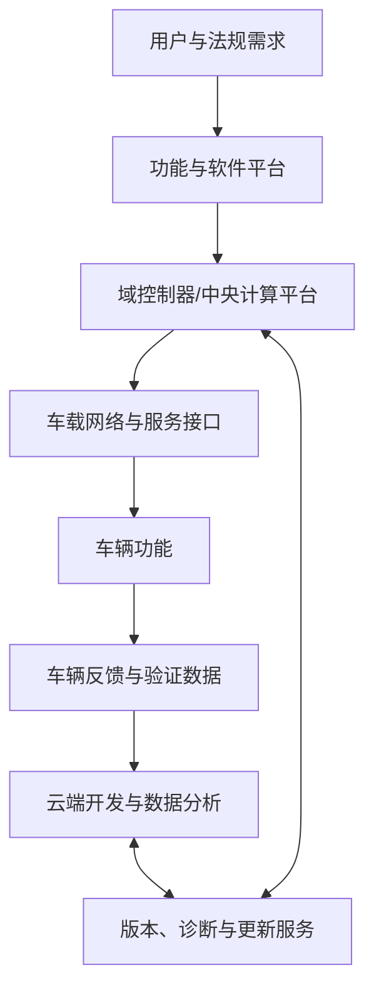
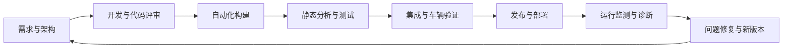

# 软件定义汽车（SDV）

> 软件定义汽车（Software-Defined Vehicle，SDV）强调通过可持续演进的软件、可更新的电子电气架构和服务体系来扩展车辆功能。它不是“汽车里有很多软件”的同义词，关键在于软件能力如何被开发、部署、验证、更新和长期维护。

## 1. 核心变化

传统上，车辆功能可能与特定 ECU、硬件和供应商软件紧密绑定。SDV 方向倾向于提高软件组件的可复用性、计算资源的统筹能力、车辆数据的可管理性，以及交付后的软件更新能力。不同车企的实现路线并不完全相同。

图中表示一种概念性闭环，并不代表所有车辆都具备相同的云端连接或集中式计算架构。

## 2. 关键技术支柱

- **电子电气架构演进**：从大量分散 ECU 向域控制、区域控制或中央计算等方向发展。
- **软件平台化**：统一接口、基础服务、组件复用和软件生命周期管理。
- **车载通信**：支持带宽、时延、确定性和安全要求不同的网络与网关策略。
- **持续集成与验证**：通过自动化构建、静态分析、单元测试、集成测试和回归测试控制变更风险。
- **软件更新与配置管理**：管理软件包、兼容关系、版本、签名、安装状态与回滚策略。
- **数据与网络安全**：限制访问、保护更新链路、处理漏洞并管理车端数据。
- **功能安全与可靠性**：分析故障影响，并为安全相关功能设计检测、降级和恢复机制。

## 3. 软件交付生命周期

车辆软件更新还需要考虑电源稳定性、安装前置条件、版本兼容、失败恢复、回滚、用户告知和法规约束，不能简单照搬普通 Web 应用的发布方式。

## 4. 主要工程挑战

| 挑战 | 需要回答的问题 |
|---|---|
| 复杂度 | 如何控制跨域依赖、服务接口和变体数量？ |
| 实时性 | 共享计算资源后，关键任务如何保证时限？ |
| 安全性 | 更新或服务故障时，车辆如何维持安全状态？ |
| 兼容性 | 新版本与硬件、标定、诊断和其他 ECU 是否兼容？ |
| 可验证性 | 如何证明更新没有破坏既有功能？ |
| 生命周期 | 如何支持多年运行、漏洞修复和供应链组件管理？ |

## 5. 与 AUTOSAR 的关系

AUTOSAR 是汽车软件标准化的重要组成部分，但不是 SDV 的全部。Classic Platform 常用于具有明确实时约束的嵌入式控制场景；Adaptive Platform 面向更高性能的计算场景及相应服务化能力。具体选型取决于功能、硬件、时序、安全和项目约束，不能简单理解为新平台完全取代旧平台。

## 6. 建议学习路线

1. 理解 [[电子电气架构]] 与 [[整车平台]]。
2. 掌握 [[AUTOSAR]]、软件组件、接口和配置管理。
3. 学习车载网络、诊断、功能安全与网络安全基础。
4. 理解自动化构建、软件版本管理、回归测试和更新机制。
5. 通过一个具体功能追踪需求、设计、代码、测试和发布证据。

## 7. 原始资料与阅读提示

- [Deloitte：软件定义汽车](https://www2.deloitte.com/cn/zh/pages/consumer-business/articles/software-defined-cars-industrial-revolution-on-the-arrow.html)

阅读行业文章时，应记录发布日期和讨论范围，并与标准、法规、车企公开技术资料交叉核对；行业趋势不等于所有量产项目的现状。

## 8. 相关笔记

- [[汽车电子]]
- [[电子电气架构]]
- [[整车平台]]
- [[AUTOSAR]]
- [[Software Architecture]]
- [[Configuration]]
- [[Development Process]]