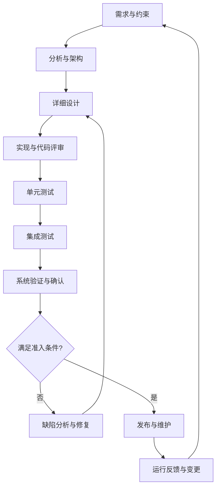

# 软件工程

> 软件工程使用系统化、可度量和可重复的方法开发、交付、运行与维护软件。目标不仅是“让程序能运行”，还包括控制成本、风险、质量和长期变更。

## 1. 软件工程的基本要素

- **方法**：需求分析、架构设计、编码、测试、评审和维护的方法。
- **工具**：版本控制、构建系统、静态分析、调试器、测试框架和持续集成平台。
- **过程**：角色、活动、输入输出、评审关口和质量记录。
- **人员与协作**：职责分工、沟通机制、知识传递和变更决策。
- **证据**：需求追踪、评审记录、测试结果、缺陷记录和发布基线。

## 2. 软件生命周期

不同过程模型对活动顺序、迭代方式和评审关口的安排不同，但需求、实现、验证、配置管理和维护都需要被妥善处理。

## 3. 验证与确认的区别

- **验证（Verification）**：检查工作产品是否符合规定的要求，例如代码是否符合接口规范、测试是否覆盖需求。
- **确认（Validation）**：检查最终系统是否满足预期用途和用户/系统需求。

两者相互补充。通过了单元测试，不代表系统已经满足全部用户需求；通过了需求评审，也不代表实现没有缺陷。

## 4. 质量活动与典型产物

| 活动 | 典型产物 | 主要目的 |
|---|---|---|
| 需求管理 | 需求条目、追踪关系、变更记录 | 保持需求清晰且可追踪 |
| 架构与设计 | 架构图、接口定义、设计决策 | 控制复杂度和依赖 |
| 代码管理 | 版本历史、评审记录、静态分析结果 | 保证可追溯和可维护 |
| 测试 | 测试计划、用例、报告、覆盖率 | 提供质量证据 |
| 配置管理 | 基线、版本清单、构建配置 | 保证结果可复现 |
| 缺陷管理 | 缺陷描述、根因、修复与回归证据 | 防止问题反复发生 |
| 发布维护 | 发布说明、兼容性、回滚计划 | 控制交付风险 |

## 5. 在汽车嵌入式项目中的实践

汽车软件通常需要更严格地管理需求追踪、硬件和软件配置、接口兼容、工具链版本、故障处理及验证证据。具体项目是否适用某项标准或流程要求，应根据合同、法规、组织流程和项目安全等级确定。

常见实践包括：
- 将系统需求分解到软件需求、设计、代码和测试；
- 固化编译器、生成器、基础软件和配置版本；
- 对通信信号、诊断服务和接口变更进行影响分析；
- 为缺陷修复添加回归测试，避免只验证单点修复；
- 保留可复现的构建信息和发布记录。

## 6. 常见误区

1. 把流程文档数量当成软件质量。
2. 只在项目末尾测试，导致问题发现过晚。
3. 代码修改没有需求或缺陷关联，难以追溯原因。
4. 只记录“测试通过”，没有环境、版本和实际结果。
5. 依赖个人经验而缺少可重复的构建、评审与验证步骤。

## 7. 相关笔记

- [[架构设计]]
- [[Software Architecture]]
- [[Development Process]]
- [[ISO Standards]]
- [[Standards]]
- [[Git]]
- [[Tools]]
- [[AUTOSAR]]