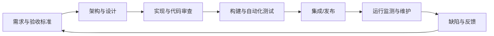

# 软件工程：以可重复的方法交付可靠软件

软件工程将计算机科学、数学、工程方法和项目管理结合起来，目标是在约束条件下交付满足需求、质量可验证且可持续维护的软件。

## 软件工程的三个基本支柱

- **方法**：需求分析、架构设计、实现、测试、维护和风险管理的方法。
- **工具**：版本控制、构建系统、静态分析、测试框架、调试器和持续集成。
- **过程**：定义工作顺序、角色、评审、交付物和质量门槛。

## 从需求到维护

## 质量属性

- 正确性：功能是否满足需求和边界条件？
- 可靠性：故障是否可检测、隔离和恢复？
- 可维护性：代码与设计是否便于理解、修改和测试？
- 可移植性：对平台和环境的依赖是否清楚？
- 安全性：是否识别并处理了相关威胁和风险？
- 可追溯性：需求、代码、构建版本和测试结果是否能够关联？

## 实践清单

1. 将需求写成可验证的验收条件。
2. 为模块定义清晰接口和错误语义。
3. 将代码、配置和脚本纳入版本控制。
4. 对关键逻辑执行代码审查、静态分析和自动化测试。
5. 记录构建环境、依赖版本和发布工件。
6. 把线上/现场缺陷转化为可重复的回归测试。

具体过程应根据项目规模、风险和合规要求裁剪，而不是机械套用单一流程。