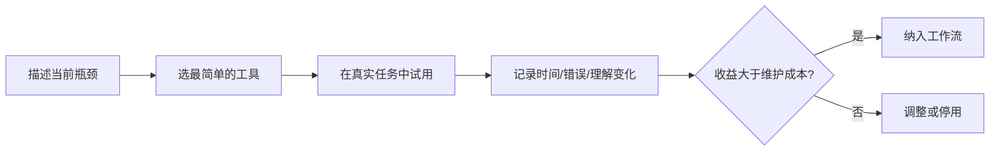

# 辅助学习工具

辅助工具用于解决一个具体瓶颈，例如帮助主动回忆、可视化系统关系、记录实验、保持专注或减少重复劳动。

## 工具类别与使用目标

- **闪卡/间隔复习**：检查能否主动回忆核心概念。
- **思维导图/概念图**：探索主题关系和知识缺口。
- **计时器/专注记录**：观察任务时长与中断模式。
- **截图/录屏/标注**：保留难以用文字描述的状态和操作。
- **代码运行/模拟/测试工具**：验证技术假设和边界条件。
- **语音记录**：快速捕捉想法，之后应转成可检索的摘要。

## 选择与验证流程

## 使用原则

- 不要为了使用工具而改变目标。
- 先用最小功能验证价值，再增加插件和自动化。
- 记录数据导出、备份和恢复方法。
- 对复习工具定期删除含糊、过时或重复的卡片。
- 对可视化工具，每张图都应回答一个明确问题。