# 好书推荐

> 数据同步自 [ilikui/home 的 book.json](https://github.com/ilikui/home/blob/main/static/data/book.json)，共 **16 本**。书名、封面、豆瓣链接、作者、标签、阅读状态及个人短评按源数据整理；重新同步时以源 JSON 为准。

<!-- BOOKS:AUTO-GENERATED:START -->
> 本区块由 `ilikui/home/static/data/book.json` 自动生成，共 **16 本**。请在源 JSON 中维护书籍数据；本区块会在同步时整体更新。

## 书单总览

### 1. [白夜行](https://book.douban.com/subject/10554308/)

- **作者：** [日] 东野圭吾
- **分类/标签：** 悬疑
- **阅读状态：** 已读
- **豆瓣评分：** 9.2/10（546129 人评价）

### 2. [运动改造大脑](https://book.douban.com/subject/36418973/)

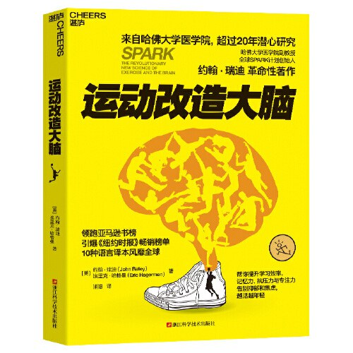

- **作者：** （美）约翰 · 瑞迪、埃里克 · 哈格曼 著
- **分类/标签：** 科学、知识
- **阅读状态：** 待读
- **豆瓣评分：** 7.6/10（1127 人评价）

### 3. [认知觉醒](https://book.douban.com/subject/35193035/)

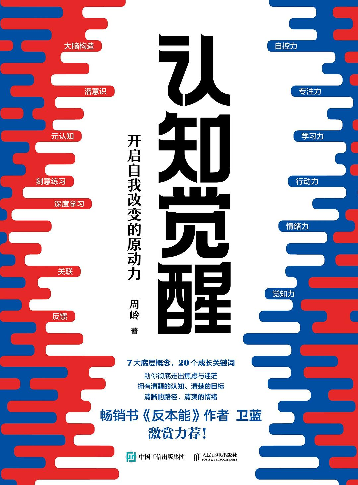

- **作者：** 周岭
- **分类/标签：** 读书、认知
- **阅读状态：** 在读
- **豆瓣评分：** 8/10（38242 人评价）

### 4. [南部档案](https://book.douban.com/subject/35501244/)

- **作者：** 南派三叔
- **分类/标签：** 小说
- **阅读状态：** 已读
- **豆瓣评分：** 6.8/10（1893 人评价）

### 5. [仿生人会梦见电子羊吗？](https://book.douban.com/subject/27041533/)

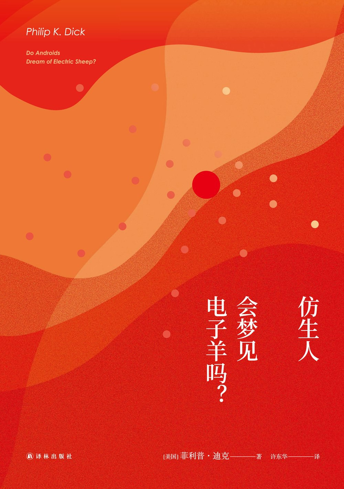

- **作者：** [美] 菲利普·迪克
- **分类/标签：** 未分类
- **阅读状态：** 待读
- **豆瓣评分：** 8.7/10（31272 人评价）

### 6. [高效能人士的七个习惯](https://book.douban.com/subject/5325618/)

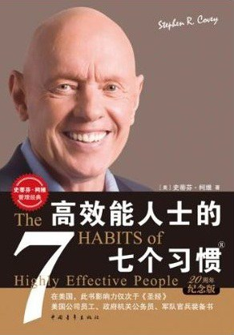

- **作者：** [美] 史蒂芬·柯维
- **分类/标签：** 知识
- **阅读状态：** 待读
- **豆瓣评分：** 8.5/10（24142 人评价）

### 7. [笔记的方法](https://book.douban.com/subject/36615020/)

- **作者：** 刘少楠、刘白光
- **分类/标签：** 读书
- **阅读状态：** 已读
- **豆瓣评分：** 8/10（2367 人评价）

### 8. [老兵新传](https://book.douban.com/subject/20414972/)

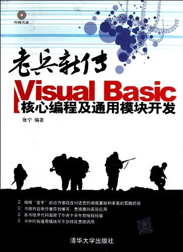

- **作者：** 张宁
- **分类/标签：** 编程
- **阅读状态：** 待读
- **豆瓣评分：** 0/10（0 人评价）

### 9. [学习究竟是什么](https://book.douban.com/subject/35082292/)

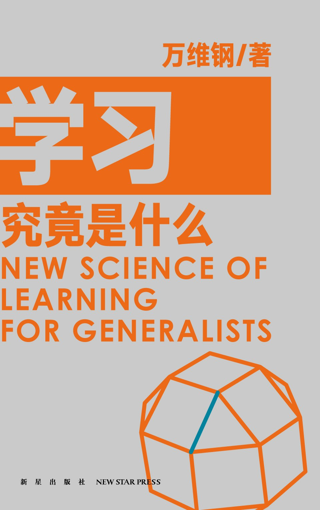

- **作者：** 万维钢
- **分类/标签：** 未分类
- **阅读状态：** 待读
- **豆瓣评分：** 7.9/10（1519 人评价）

### 10. [程序设计实践](https://book.douban.com/subject/1173548/)

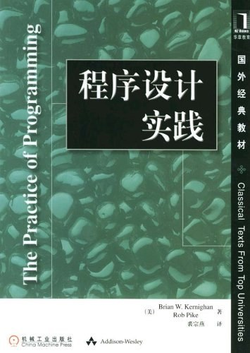

- **作者：** [美] Brian W. Kernighan、Rob Pike
- **分类/标签：** 未分类
- **阅读状态：** 待读
- **豆瓣评分：** 9.1/10（504 人评价）

### 11. [数据结构（C语言版）](https://book.douban.com/subject/24699581/)

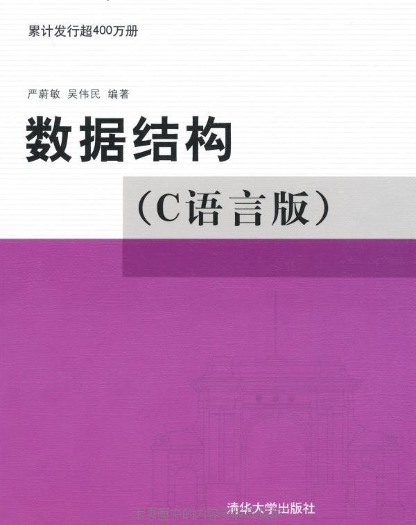

- **作者：** 严蔚敏、吴伟民
- **分类/标签：** 编程
- **阅读状态：** 在读
- **豆瓣评分：** 6.1/10（500 人评价）

### 12. [CANoe开发从入门到精通](https://book.douban.com/subject/33438308/)

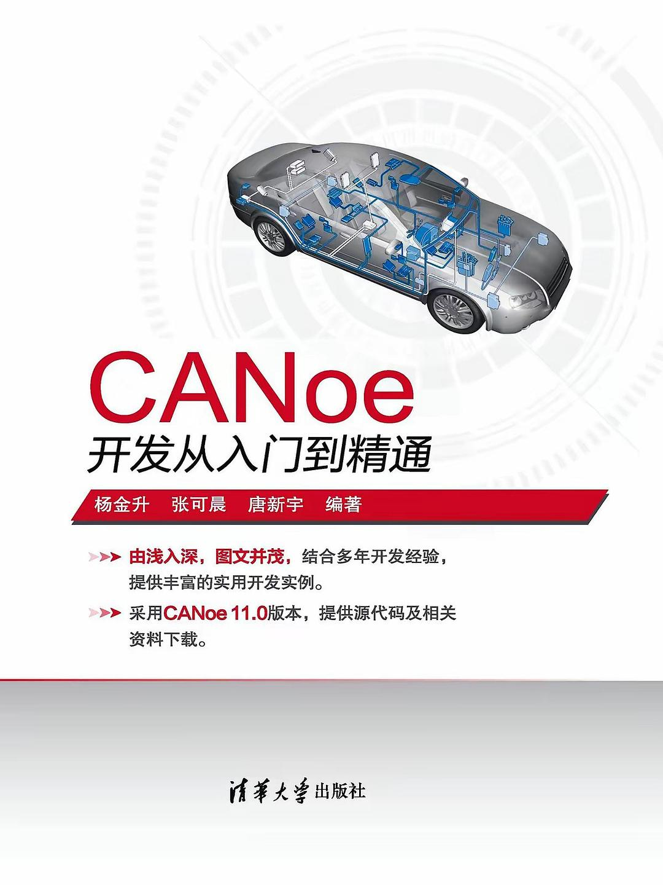

- **作者：** 杨金升、张可晨、唐新宇
- **分类/标签：** 通信
- **阅读状态：** 在读
- **豆瓣评分：** 8/10（12 人评价）

### 13. [高效能人士的笔记整理术](https://book.douban.com/subject/30168344/)

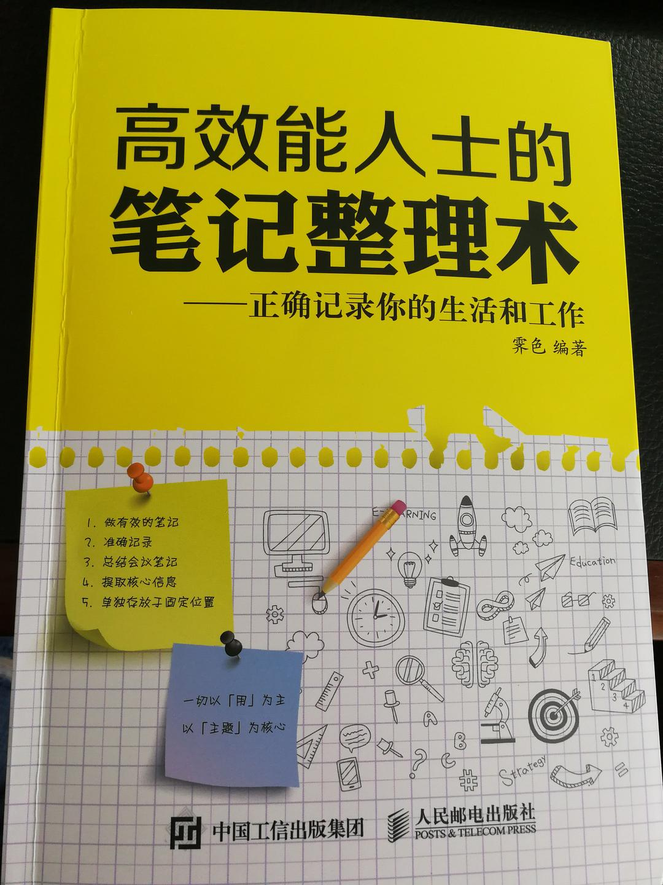

- **作者：** 霁色
- **分类/标签：** 笔记
- **阅读状态：** 已读
- **豆瓣评分：** 5.8/10（223 人评价）

### 14. [富爸爸，穷爸爸](https://book.douban.com/subject/1033778/)

- **作者：** （美）罗伯特·T·清崎、莎伦·L·莱希特、[美] 罗伯特·清崎
- **分类/标签：** 理财
- **阅读状态：** 已读
- **豆瓣评分：** 8.3/10（83584 人评价）

### 15. [Simulink仿真及代码生成技术入门到精通](https://book.douban.com/subject/26899960/)

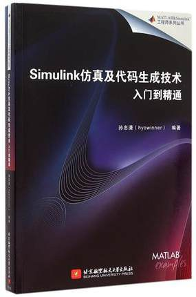

- **作者：** 孙忠潇
- **分类/标签：** Simulink
- **阅读状态：** 已读
- **豆瓣评分：** 8.8/10（19 人评价）

### 16. [匆匆那年](https://book.douban.com/subject/4172417/)

- **作者：** 九夜茴
- **分类/标签：** 未分类
- **阅读状态：** 待读
- **豆瓣评分：** 8.1/10（11758 人评价）

## 书籍详情

### 1. 白夜行

- **作者：** [日] 东野圭吾
- **分类/标签：** 悬疑
- **阅读状态：** 已读
- **豆瓣评分：** 9.2/10（546129 人评价）
- **版本信息：** [日] 东野圭吾 / 2013 / 南海出版公司
- **豆瓣链接：** [查看《白夜行》](https://book.douban.com/subject/10554308/)
- **个人短评：** 天使与恶魔，是因为不幸的童年

### 2. 运动改造大脑

- **作者：** （美）约翰 · 瑞迪、埃里克 · 哈格曼 著
- **分类/标签：** 科学、知识
- **阅读状态：** 待读
- **豆瓣评分：** 7.6/10（1127 人评价）
- **版本信息：** （美）约翰 · 瑞迪 埃里克 · 哈格曼 著 / 2023 / 浙江科学技术出版社
- **豆瓣链接：** [查看《运动改造大脑》](https://book.douban.com/subject/36418973/)

### 3. 认知觉醒

- **作者：** 周岭
- **分类/标签：** 读书、认知
- **阅读状态：** 在读
- **豆瓣评分：** 8/10（38242 人评价）
- **版本信息：** 周岭 / 2020 / 人民邮电出版社
- **豆瓣链接：** [查看《认知觉醒》](https://book.douban.com/subject/35193035/)
- **个人短评：** 认知觉醒的一刻

### 4. 南部档案

- **作者：** 南派三叔
- **分类/标签：** 小说
- **阅读状态：** 已读
- **豆瓣评分：** 6.8/10（1893 人评价）
- **版本信息：** 南派三叔 / 2021 / 江苏凤凰文艺出版社
- **豆瓣链接：** [查看《南部档案》](https://book.douban.com/subject/35501244/)

### 5. 仿生人会梦见电子羊吗？

- **作者：** [美] 菲利普·迪克
- **分类/标签：** 未分类
- **阅读状态：** 待读
- **豆瓣评分：** 8.7/10（31272 人评价）
- **版本信息：** [美] 菲利普·迪克 / 2017 / 译林出版社
- **豆瓣链接：** [查看《仿生人会梦见电子羊吗？》](https://book.douban.com/subject/27041533/)

### 6. 高效能人士的七个习惯

- **作者：** [美] 史蒂芬·柯维
- **分类/标签：** 知识
- **阅读状态：** 待读
- **豆瓣评分：** 8.5/10（24142 人评价）
- **版本信息：** [美] 史蒂芬·柯维 / 2018 / 中国青年出版社
- **豆瓣链接：** [查看《高效能人士的七个习惯》](https://book.douban.com/subject/5325618/)
- **个人短评：** 如何高效

### 7. 笔记的方法

- **作者：** 刘少楠、刘白光
- **分类/标签：** 读书
- **阅读状态：** 已读
- **豆瓣评分：** 8/10（2367 人评价）
- **版本信息：** 刘少楠 刘白光 / 2023 / 新星出版社
- **豆瓣链接：** [查看《笔记的方法》](https://book.douban.com/subject/36615020/)
- **个人短评：** 如何做好卡片笔记

### 8. 老兵新传

- **作者：** 张宁
- **分类/标签：** 编程
- **阅读状态：** 待读
- **豆瓣评分：** 0/10（0 人评价）
- **版本信息：** 张宁 / 2013 / 清华大学出版社
- **豆瓣链接：** [查看《老兵新传》](https://book.douban.com/subject/20414972/)

### 9. 学习究竟是什么

- **作者：** 万维钢
- **分类/标签：** 未分类
- **阅读状态：** 待读
- **豆瓣评分：** 7.9/10（1519 人评价）
- **版本信息：** 万维钢 / 2020 / 新星出版社
- **豆瓣链接：** [查看《学习究竟是什么》](https://book.douban.com/subject/35082292/)

### 10. 程序设计实践

- **作者：** [美] Brian W. Kernighan、Rob Pike
- **分类/标签：** 未分类
- **阅读状态：** 待读
- **豆瓣评分：** 9.1/10（504 人评价）
- **版本信息：** [美] Brian W. Kernighan Rob Pike / 2000 / 机械工业出版社
- **豆瓣链接：** [查看《程序设计实践》](https://book.douban.com/subject/1173548/)

### 11. 数据结构（C语言版）

- **作者：** 严蔚敏、吴伟民
- **分类/标签：** 编程
- **阅读状态：** 在读
- **豆瓣评分：** 6.1/10（500 人评价）
- **版本信息：** 严蔚敏 吴伟民 / 2012 / 清华大学出版社
- **豆瓣链接：** [查看《数据结构（C语言版）》](https://book.douban.com/subject/24699581/)
- **个人短评：** 数据结构与算法

### 12. CANoe开发从入门到精通

- **作者：** 杨金升、张可晨、唐新宇
- **分类/标签：** 通信
- **阅读状态：** 在读
- **豆瓣评分：** 8/10（12 人评价）
- **版本信息：** 杨金升、张可晨、唐新宇 / 2019 / 清华大学出版社
- **豆瓣链接：** [查看《CANoe开发从入门到精通》](https://book.douban.com/subject/33438308/)
- **个人短评：** Canoe工具的使用

### 13. 高效能人士的笔记整理术

- **作者：** 霁色
- **分类/标签：** 笔记
- **阅读状态：** 已读
- **豆瓣评分：** 5.8/10（223 人评价）
- **版本信息：** 霁色 / 人民邮电出版社
- **豆瓣链接：** [查看《高效能人士的笔记整理术》](https://book.douban.com/subject/30168344/)
- **个人短评：** 看看自己如何整理自己笔记

### 14. 富爸爸，穷爸爸

- **作者：** （美）罗伯特·T·清崎、莎伦·L·莱希特、[美] 罗伯特·清崎
- **分类/标签：** 理财
- **阅读状态：** 已读
- **豆瓣评分：** 8.3/10（83584 人评价）
- **版本信息：** （美）罗伯特·T·清崎 莎伦·L·莱希特 [美] 罗伯特·清崎 / 2000 / 世界图书出版公司
- **豆瓣链接：** [查看《富爸爸，穷爸爸》](https://book.douban.com/subject/1033778/)
- **个人短评：** 你不理财，财不理你

### 15. Simulink仿真及代码生成技术入门到精通

- **作者：** 孙忠潇
- **分类/标签：** Simulink
- **阅读状态：** 已读
- **豆瓣评分：** 8.8/10（19 人评价）
- **版本信息：** 孙忠潇 / 2015 / 北京航空航天大学出版社
- **豆瓣链接：** [查看《Simulink仿真及代码生成技术入门到精通》](https://book.douban.com/subject/26899960/)

### 16. 匆匆那年

- **作者：** 九夜茴
- **分类/标签：** 未分类
- **阅读状态：** 待读
- **豆瓣评分：** 8.1/10（11758 人评价）
- **版本信息：** 九夜茴 / 2009 / 东方出版社
- **豆瓣链接：** [查看《匆匆那年》](https://book.douban.com/subject/4172417/)

<!-- BOOKS:AUTO-GENERATED:END -->

## 如何建立可复用的书单

书籍来源可从 [豆瓣读书](https://book.douban.com/) 等平台发现，但评分和推荐只用于筛选，不代替内容质量判断。选择书籍时优先考虑当前问题、作者专业背景、证据质量、出版时间和可实践程度。

## 推荐书目记录模板

| 字段      | 记录方式                       |
| --------- | ------------------------------ |
| 书名/作者 | 使用正式书名与作者姓名         |
| 主题      | 技术、文学、心理、历史、管理等 |
| 阅读状态  | 待读、在读、已读、暂缓、重读   |
| 阅读目的  | 读完希望解决什么问题           |
| 核心观点  | 用自己的话概括，不仅记录目录   |
| 相关卡片  | 链接到卡片笔记或对应专题       |
| 输出成果  | 文章、项目、讨论或实践         |

## 从读完一本书到真正掌握

不要以读完数量作为唯一指标。一本书若改变了一个判断、帮助解决一个问题或形成一个可复用的解释，就已经产生了实际价值。
