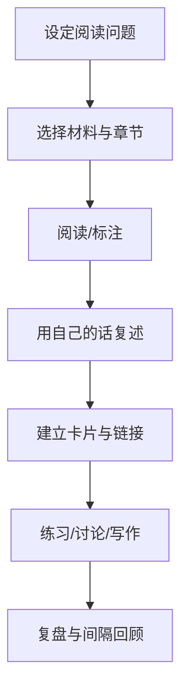

# 阅读管理：从输入到理解和输出

阅读的目标因材料而异：查找资料重在定位答案，学习教材重在建立概念模型，读经典作品重在理解文本与提出问题。不要用同一种摘录方式处理所有阅读任务。

## 阅读闭环

## 阅读记录模板

- 书名/作者/版本：
- 阅读目的与问题：
- 核心观点（自己的话）：
- 关键证据或案例：
- 我赞同/质疑的地方：
- 与已有知识的连接：
- 下一步行动或输出：
- 需要复查的章节/页码：

## 不同材料的处理方式

- 技术文档：记录版本、接口、约束、示例和适用条件。
- 学术文章：记录研究问题、方法、样本/数据、结论和局限。
- 小说与人文作品：记录人物动机、叙事视角、冲突、主题与文本证据。
- 网页和视频：保存原始链接、作者、发布时间和关键时间点。
- 工程问题资料：记录复现条件、解决方案和未解决的边界情况。

## 推荐习惯

先带着问题读，读后合上材料复述，再回到原文校验。摘录应保留出处；个人解释应与作者原话区分。定期把阅读所得用于文章、代码、方案或讨论，检验理解是否能迁移。
