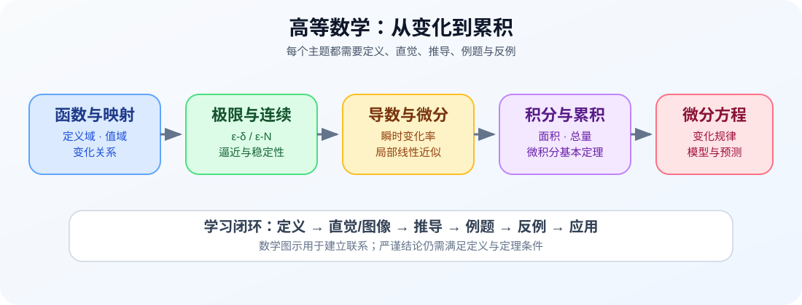
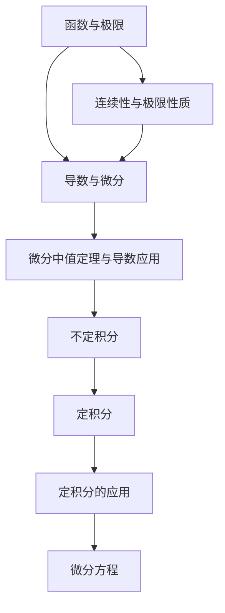

# 高等数学学习地图

{:height 552, :width 818}

> 高等数学学习的关键不是记住公式列表，而是理解定义、定理的条件、推导逻辑，以及如何用计算和图像检验结果。

## 学习路径

## 第一章 函数与极限

- 第一节 映射与函数
  - [[映射]]
  - [[函数]]
- 第二节 数列与极限
  - [[数列极限的定义]]
  - 收敛数列的性质
- 第三节 函数的极限
  - 函数极限的定义
  - 函数极限的性质
- 第四节 无穷小与无穷大
  - 无穷小
  - 无穷大
- 第五节 极限运算法则
- 第六节 极限存在准则与两个重要极限
- 第七节 无穷小的比较
- 第八节 函数的连续性与间断点
  - 函数的连续性
  - 函数的间断点
- 第九节 连续函数的运算与初等函数的连续性
  - 连续函数的和、差、积、商的连续性
  - 反函数与复合函数的连续性
  - 初等函数的连续性
- 第十节 闭区间上连续函数的性质
  - 有界性与最大值最小值定理
  - 零点定理与介值定理
  - 一致连续性

## 第二章 导数与微分

- 第一节 [[导数的概念]]
- 第二节 [[函数的求导法则]]
- 第三节 高阶导数
- 第四节 隐函数及参数方程所确定的函数的导数、相关变化率
- 第五节 函数的微分

## 第三章 微分中值定理与导数的应用

- 微分中值定理
- 洛必达法则
- 泰勒公式
- 函数的单调性与曲线的凹凸性
- 函数的极值与最大值最小值
- 函数图形的描绘
- 曲率
- 方程的近似解

## 第四章 不定积分

- 不定积分的概念与性质
- 换元积分法
- 分部积分法
- 有理函数的积分
- 积分表的使用

## 第五章 定积分

- 定积分的概念与性质
- 微积分基本公式
- 定积分的换元法和分部积分法
- 反常积分
- 反常积分的收敛性

## 第六章 定积分的应用

从面积、体积、弧长、功和平均值等实际问题建立积分模型，重点理解“累积量”与积分上下限的含义。

## 第七章 微分方程

- 微分方程的基本概念
- 可分离变量的微分方程
- 后续内容按课程大纲继续补充

## 每个章节的学习模板

1. **定义**：逐字理解定义中的量词、条件和范围。
2. **直觉**：画图或用具体数值解释定义。
3. **定理**：记录前提条件、结论和证明思路。
4. **例题**：先独立求解，再比较标准步骤。
5. **反例**：找出遗漏某个条件时结论为何可能失效。
6. **练习**：覆盖基础题、变式题和综合题。
7. **复盘**：记录错误原因，并在间隔一段时间后重新完成。

## 常见学习误区

- 只记公式，不检查使用条件。
- 把图像直觉当作严格证明。
- 计算中忽略定义域、符号和极限存在条件。
- 只做熟悉题型，缺少变式与综合练习。
- 错题只抄正确过程，不记录最初错误发生在哪一步。

本页是学习地图；各章节的详细定义、证明和习题应继续沉淀到独立专题页，并通过链接保持结构清晰。
